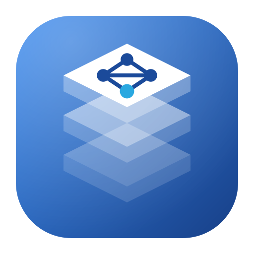

<p align="center">
  
</p>

<h1 align="center">GNOME Local AI Workstation</h1>

<p align="center">
  <strong>Know what your machine can run, then measure it.</strong><br>
  A native GTK4/Libadwaita control plane for local AI models on Linux.
</p>

<p align="center">
  <a href="docs/04-roadmap/milestones.md">Roadmap</a> ·
  <a href="docs/README.md">Documentation</a> ·
  <a href="CONTRIBUTING.md">Contributing</a> ·
  <a href="COPYING">GPL-3.0-or-later</a>
</p>

Running a local model starts with guesswork: will a 7B Q4_K_M fit in 6 GB of VRAM, what
happens at 32K context, and is Ollama already holding the file you are about to download?
Local AI Workstation answers those questions on your own hardware, with the arithmetic
shown, and then lets you check the answer with a real benchmark.

It is a local inference **control plane**, not a chatbot, a custom inference engine, or a
privileged daemon. It needs no root, sends no telemetry, and never guesses: when data is
missing the answer is `Unknown`, not an optimistic fit.

## Who it is for

Linux developers who run models locally, for coding assistants, tooling, or experiments,
on a laptop or workstation with one GPU, an APU with shared memory, or only a CPU. If you
juggle Ollama, llama.cpp, and Hugging Face downloads and want to know why a model is slow
or does not fit, this is for you.

## What it does today

| Capability | What you get |
| --- | --- |
| Hardware discovery | CPU and RAM, NVIDIA VRAM through NVML, AMD VRAM and GTT through sysfs |
| Three memory pools | Dedicated VRAM, shared GPU memory (GTT), and system RAM are kept separate; shared GPU memory is never added to host RAM |
| Memory fit | Weights, K/V cache, compute buffers, and runtime allowance for LLaMA and Qwen2 GGUF files at an explicit context, with a per-component breakdown |
| Attached Ollama | Read-only discovery and inspection of an existing Ollama server; the application never stops it, changes its units, or deletes its models |
| Quick Benchmark | One explicit, local-only streaming request with cancellation, server decode rate, and sampled RAM/VRAM/GTT peaks |
| History and verification | SQLite run history, and a `Benchmark Verified` badge tied to the exact Ollama manifest and hardware, restored after restart |

## How it works

```text
GGUF header ─┐
Settings     ─┼─► fit estimate ──► Comfortable / Constrained / Not recommended / Unknown
Live memory  ─┘                              │
                                             ▼
                          Quick Benchmark ──► SQLite history ──► Benchmark Verified
```

Fit estimates are conditional on the scenario you supply (context length, K/V type, batch
size, and an attention-layout assumption). A saved benchmark proves one prior request, not
every future context or placement, and the interface says so.

## Status

**M0 is complete for the accepted reference baseline and merged into `main`.** Real Qwen
CUDA inference and verification after a separate-process restart passed on an RTX 4050
laptop; see the [M0 acceptance record](docs/03-development/m0-acceptance.md) for
measurements and limits. The measured native GTK/CUDA results on Hyprland were accepted
on 2026-10-26. GNOME-session validation remains a follow-up and is not claimed as tested.

**M1 is implemented on `develop` and awaiting sign-off.** The Models page searches Hugging Face
GGUF repositories, shows a file's header and a conditional fit, notes files you already have
in Ollama, the Hugging Face cache or the application's store, downloads with pause, resume
and checksum verification, and keeps a gated-model token in your desktop keyring. A live run
on the reference machine is recorded in the
[M1 acceptance evidence](docs/03-development/m1-acceptance.md); the stored-token restart
check passed. See the [M1 plan](docs/04-roadmap/m1/Planned.md). Managed runtimes,
controlled benchmark comparisons, and more hardware matrices come in M2 to M4; the
[roadmap](docs/04-roadmap/milestones.md) tracks them.

This is an independent community project; it is not an official GNOME application or a
GNOME Circle member.

## Principles

- **Honest by default:** missing metadata stays `Unknown`; unmeasured memory channels are
  reported with coverage limits, never as zero.
- **Local first:** no usage analytics or crash uploads. Network requests happen only after
  an explicit action.
- **Do not touch what you do not own:** an attached runtime is read-only; no root required.
- **Reproducible:** tests need no GPU, model download, running runtime, or internet.

## Get started

Use Linux, Rust stable (1.92+), GTK 4.12+, Libadwaita 1.4+,
a C toolchain, and pkg-config. See the
[development guide](docs/03-development/getting-started.md) for system dependencies.

```sh
cargo run --locked -p workstation-app
```

The shell does not require Ollama, a GPU, or model downloads. It makes no network
requests at startup. Cargo may download build dependencies.

Exercise the core calculator without a GPU, model, or runtime:

```sh
cargo run --locked -p workstation-core --example memory_fit
```

The example clearly labels synthetic inputs. The API estimates weights, separate K/V
cache storage, buffers, and runtime allowance, then classifies one selected CPU/GPU
placement. Missing metadata or unverified compatibility remains Unknown; shared memory
is never added to host RAM. This does not grant benchmark verification. See the
[calculator guide](docs/03-development/static-memory-fit.md) for scope and checks.

For local GGUF inspection, see the [metadata guide](docs/03-development/gguf-metadata.md).
This reports declarations and tensor layout; runtime compatibility remains unverified.
The [GGUF fit scenario guide](docs/03-development/gguf-fit.md) connects those
declarations to explicit settings and a supplied budget. It requires an explicit
layout assumption for a breakdown and cannot return a positive fit classification.
Use the [desktop CPU workflow](docs/03-development/desktop-cpu-fit.md) to select a
local file and configure a scenario directly in Overview. Use the
[Ollama inspection workflow](docs/03-development/ollama-inspection.md) to inspect an
installed model in Runtimes. Those inspection workflows do not run inference.
The [Quick Benchmark workflow](docs/03-development/quick-benchmark.md) sends one
fixed inference request only after Check and Run in Benchmark Lab.
The [benchmark history guide](docs/03-development/benchmark-history.md) explains
durable snapshots, storage errors, and unfinished runs.
The [memory sampling guide](docs/03-development/benchmark-memory-sampling.md) explains
observed peaks, unknown channels, and system/device attribution limits.

```sh
cargo fmt --all --check
cargo clippy --workspace --all-targets --locked -- -D warnings
cargo test --workspace --locked
python3 scripts/check_repository.py
```

## Repository

Source repository: [dexterhere/kvlm](https://github.com/dexterhere/kvlm).

| Path | Responsibility |
| --- | --- |
| `crates/workstation-core/` | Domain types, hardware probes, fit, models, SQLite, exports |
| `crates/workstation-runtimes/` | Runtime adapters and owned-process supervision |
| `crates/workstation-bench/` | Benchmark execution, workloads, resource sampling |
| `crates/workstation-app/` | GTK4/Libadwaita shell and Tokio/GLib bridge |
| `data/` | Desktop launcher, AppStream metadata, settings schema, icons |
| `docs/` | Ordered product, architecture, development, roadmap, decision documents |
| `tests/` | Shared fixture guidance; executable Rust tests live with their owning crate |
| `scripts/` | Repository validation |

Start with the [documentation index](docs/README.md), then read the
[master specification](docs/01-product/gnome_local_ai_workstation_master_specification.md).
The specification describes the target product, not a list of completed features.

## Contribute

Contributions to code, documentation, accessibility, testing, and hardware support
are welcome. Read [CONTRIBUTING.md](CONTRIBUTING.md), the
[Code of Conduct](CODE_OF_CONDUCT.md), and the
[milestone roadmap](docs/04-roadmap/milestones.md). Small, focused pull requests are
easier to review. Discuss changes to scope or safety boundaries before implementing them.

See [SUPPORT.md](SUPPORT.md) for questions and [SECURITY.md](SECURITY.md) for
vulnerability reporting. Private reporting and a verified maintainer contact still
need to be configured before accepting sensitive reports.

## License

GPL-3.0-or-later. See [COPYING](COPYING) for the full license. Contributions are
accepted under the same license, with no copyright assignment or contributor
license agreement. Third-party models and runtime binaries retain their own licenses.
The AppStream metadata file, including contributions to that file, is CC0-1.0 so
software catalogs can redistribute its descriptions; see [the CC0 text](LICENSES/CC0-1.0.txt).
