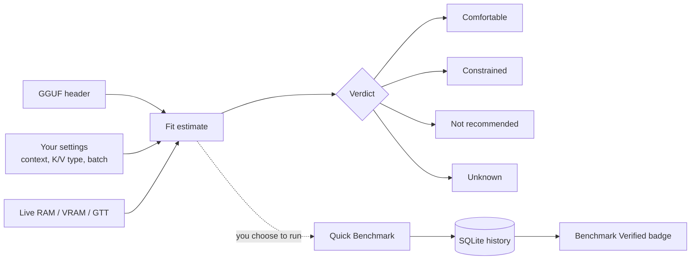
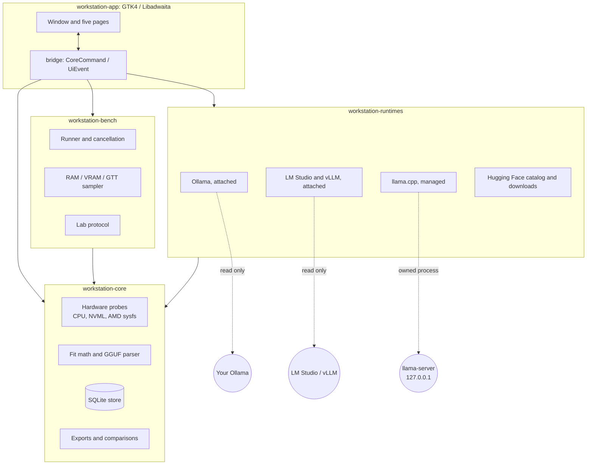
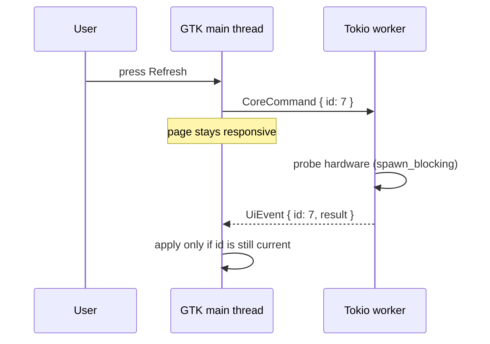
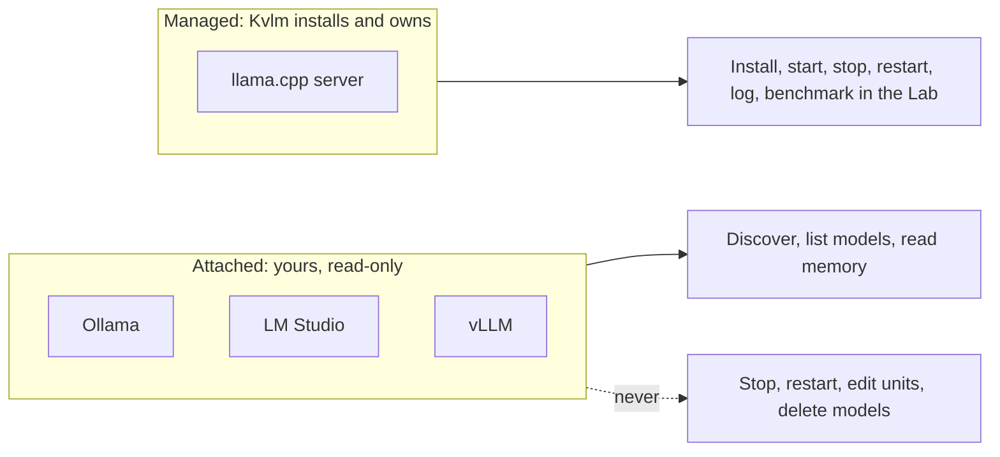
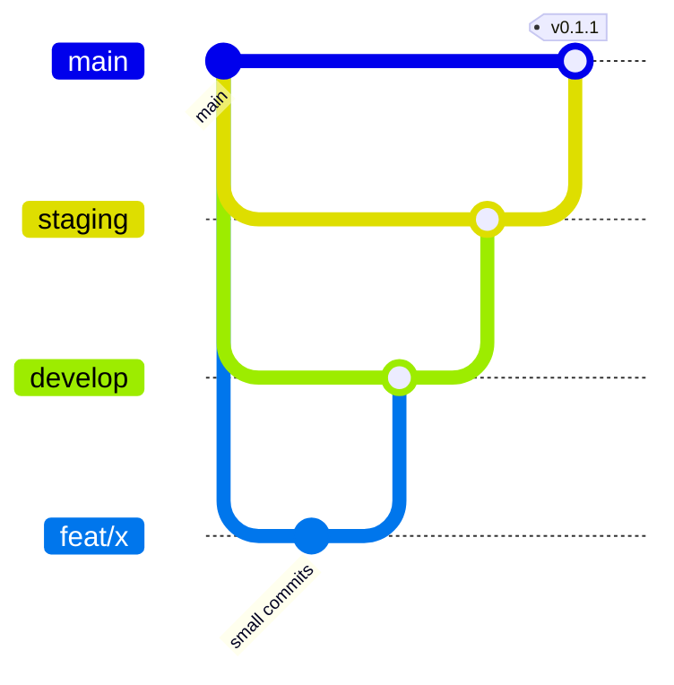

<p align="center">
  
</p>

<h1 align="center">Kvlm</h1>

<p align="center">
  <strong>Local AI Workstation for GNOME</strong><br>
  Know what your machine can run, then measure it.
</p>

<p align="center">
  <a href="https://github.com/dexterhere/kvlm/releases"></a>
  
  
  
  <a href="COPYING"></a>
</p>

<p align="center">
  <a href="#what-kvlm-is">What it is</a> ·
  <a href="#the-interface">Interface</a> ·
  <a href="#how-it-works">How it works</a> ·
  <a href="#install-and-run">Install</a> ·
  <a href="#status-of-the-011-beta">Status</a> ·
  <a href="docs/README.md">Docs</a> ·
  <a href="CONTRIBUTING.md">Contribute</a>
</p>

## What Kvlm is

**Kvlm** is the project; its desktop application is called **Local AI Workstation** (the window
title, launcher and AppStream name) and its program is `local-ai-workstation`. The repository
(`dexterhere/kvlm`) and the `KVLM_*` environment variables used by the opt-in acceptance tests
use the short name.

**The name.** Kvlm reads as **KV** + **LM**: the *key-value cache* and the *language model*. The
KV cache is the part of local inference that grows with context length and quietly decides
whether a model fits, so it is what this project is built to explain. (A maintainer-chosen
reading of the name, not a formal acronym.)

Running a local model starts with guesswork: will a 7B Q4_K_M fit in 6 GB of VRAM, what
happens at 32K context, and is Ollama already holding the file you are about to download?
Kvlm answers those questions on your own hardware, with the arithmetic shown, and then lets
you check the answer with a real benchmark.

It is a local inference **control plane**, not a chatbot, not an inference engine, and not a
privileged daemon. It needs no root, sends no telemetry, and never guesses: when data is
missing the answer is `Unknown`, not an optimistic fit.

> **Beta.** Version 0.1.1 is a pre-release for testing. It is built from source; there are no
> prebuilt binaries or store packages yet. See [status](#status-of-the-011-beta) for what has and
> has not been validated on real hardware.

**Who it is for:** Linux developers who run models locally, for coding assistants, tooling or
experiments, on a laptop or workstation with one GPU, an APU with shared memory, or only a CPU,
and who juggle Ollama, llama.cpp and Hugging Face downloads.

## The interface

Kvlm is a native GTK4/Libadwaita window with five pages, switchable with `Ctrl+1` to `Ctrl+5`.
`Ctrl+K` jumps to model search and `Ctrl+R` refreshes the current page. It works down to a
360 px wide window, where the page switcher moves to the bottom bar.

```text
┌──────────────────────────────────────────────────────────────────────────┐
│ Local AI Workstation   [Overview][Models][Runtimes][Benchmarks][Lab]  ☰  │
├──────────────────────────────────────────────────────────────────────────┤
│  Overview & Monitor                                    [ Refresh ]       │
│  ┌ Hardware ─────────────────────┐ ┌ Memory scenarios ─────────────────┐ │
│  │ CPU  8 cores · AVX2           │ │ GGUF file     [ Choose file… ]    │ │
│  │ RAM  15.3 GiB  (5.4 free)     │ │ Context tokens   [ 8192 ]         │ │
│  │ GPU  RTX 4050  VRAM 6.0 GiB   │ │ Sequences [1]  Microbatch [512]   │ │
│  │      free 5.7 GiB             │ │ [ Estimate ]                      │ │
│  └───────────────────────────────┘ │ Weights ▇▇▇▇▇▇  K/V ▇▇  Buffers ▇ │ │
│                                    │ Result: Comfortable | Unknown …   │ │
│  Updates  [ Check for updates ]    └───────────────────────────────────┘ │
├──────────────────────────────────────────────────────────────────────────┤
│ Detecting hardware · Ollama not checked                                  │
└──────────────────────────────────────────────────────────────────────────┘
```

| Page | What you do there |
| --- | --- |
| **Overview** | See CPU, RAM, VRAM and shared GPU memory; pick a local GGUF file and get a conditional memory-fit estimate with a per-component breakdown |
| **Models** | Search Hugging Face GGUF repositories, inspect a file's header and fit, see files you already have, download with pause and resume, store a gated-model token in the desktop keyring |
| **Runtimes** | Attach to Ollama (read-only), install and run a managed llama.cpp server, check LM Studio and vLLM on loopback |
| **Benchmarks** | Run one explicit Quick Benchmark against an installed Ollama model; review history and `Benchmark Verified` badges |
| **Lab** | Run a cold/warm experiment on the managed llama.cpp server, read diagnostics, compare two runs, try a one-setting follow-up |

Annotated wireframes of all five pages, the narrow layout, and the states each page can be in
are in [docs/02-architecture/ui-wireframes.md](docs/02-architecture/ui-wireframes.md). They are
drawn from the implemented widgets, not mock-ups of future work.

## How it works

### From a file to a verdict



Fit estimates are conditional on the scenario you supply. A saved benchmark proves one prior
request, not every future context or placement, and the interface says so.

### Architecture



Four crates, no `unsafe` code anywhere in the workspace.

### Threading

GTK objects live only on the GLib main thread. Work crosses to Tokio through typed commands and
comes back as typed events, each carrying an `id` so a stale reply can be dropped. Blocking
probes and database work run on blocking threads; the interface never waits on the network, a
model or a GPU.



### Who owns which runtime



Benchmarks and the Lab run only against a process Kvlm owns or, for Quick Benchmark, a
local-only Ollama request after an explicit check, because local execution of someone else's
process cannot be proven.

### Branches and releases



Feature branch → `develop` → `staging` → `main`, by pull request, merge commits only. All three
long-lived branches are protected; see [Git workflow](docs/03-development/git-workflow.md).

## What it does today

| Capability | What you get |
| --- | --- |
| Hardware discovery | CPU and RAM, NVIDIA VRAM through NVML, AMD VRAM and GTT through sysfs |
| Three memory pools | Dedicated VRAM, shared GPU memory (GTT) and system RAM kept separate; shared GPU memory is never added to host RAM |
| Memory fit | Weights, K/V cache, compute buffers and runtime allowance for LLaMA and Qwen2 GGUF files at an explicit context |
| Model catalog | Hugging Face GGUF search with pinned revisions, deduplication against Ollama and the HF cache, resumable verified downloads, keyring-only token |
| Attached runtimes | Read-only Ollama inspection; read-only LM Studio and vLLM discovery, with vLLM metrics on request |
| Managed llama.cpp | Checksum-verified portable install, launch profiles, supervised start/stop/restart on `127.0.0.1`, bounded logs |
| Quick Benchmark | One explicit local-only streaming request with cancellation, server decode rate, and sampled RAM/VRAM/GTT peaks |
| Benchmark Lab | Cold/warm protocol, stored experiments with coverage limits, four diagnostics, A/B comparison, controlled follow-up |
| Developer exports | Continue.dev, Zed and OpenCode snippets and a `systemd --user` unit, as text you copy |
| Accessibility | Named controls, keyboard shortcuts, 360 px minimum width, no information by colour alone |
| Hardware report | `local-ai-workstation --report-hardware` prints a redacted capability report for bug reports |

## Principles

- **Honest by default:** missing metadata stays `Unknown`; unmeasured memory channels are reported
  with coverage limits, never as zero.
- **Local first:** no telemetry or crash uploads. The network is touched only after you press a
  button. Startup makes no requests at all.
- **Do not touch what you do not own:** an attached runtime is read-only; no root required.
- **No stored secrets in files:** a Hugging Face token lives only in the desktop keyring.
- **Reproducible:** tests need no GPU, model download, running runtime or internet.

## Install and run

Kvlm is built from source; there are no prebuilt binaries yet. You need Linux, Rust stable
(1.92+), GTK 4.12+, Libadwaita 1.4+, Meson, Ninja, a C toolchain and pkg-config. The installer
script checks for all of that, prints the exact package command for your distribution if
something is missing (it never runs `sudo`), builds a release, and installs under `~/.local`:

```sh
git clone https://github.com/dexterhere/kvlm.git
cd kvlm
scripts/install.sh            # asks before building; --check only reports what is missing
scripts/install.sh --uninstall
```

The first launch opens a short **setup guide** (reopen it from the main menu) that explains what
Kvlm reads, what it never touches and when anything runs, then sends you to the hardware or
runtime check. The [development guide](docs/03-development/getting-started.md) has the manual
Cargo and Meson steps.

Ollama, a GPU and model downloads are all optional. Kvlm starts with no network access.
Cargo may download build dependencies.

Try the calculator without a GPU, model or runtime:

```sh
cargo run --locked -p workstation-core --example memory_fit
```

Reporting a hardware problem? Run `local-ai-workstation --report-hardware` and attach the output;
device identifiers, paths and times are removed.

## Status of the 0.1.1 beta

Version 0.1.1 is the first tagged pre-release. "Implemented" means the code exists with tests
that need no GPU, model or network and passed CI. "Validated" means a person ran it on the
stated hardware and recorded it.

| Milestone | Scope | State |
| --- | --- | --- |
| M0 | Hardware, memory fit, attached Ollama, Quick Benchmark | Complete for the accepted baseline (RTX 4050 laptop) |
| M1 | Models page, catalog, downloads, token | Implemented; live run recorded |
| M2 | Managed llama.cpp, exports | Implemented; CPU build served in a live run |
| M3 | Benchmark Lab | Implemented; toy model on CPU in a live run |
| M4 | LM Studio/vLLM, accessibility, packaging | Implemented; **validation pending** |

Not yet validated: AMD GPUs and APUs, a CPU-only AVX2 machine, GPU builds of llama.cpp, a real
chat model in the Lab, LM Studio and vLLM against live servers, a real GNOME session, and a
screen-reader pass. The list, with owners and procedures, is in
[beta status](docs/03-development/beta-status.md) and
[hardware validation procedures](docs/03-development/hardware-validation-procedures.md).
Release notes are in the [changelog](CHANGELOG.md).

This is an independent community project; it is not an official GNOME application or a GNOME
Circle member.

## Repository

| Path | Responsibility |
| --- | --- |
| `crates/workstation-core/` | Domain types, hardware probes, fit, models, SQLite, exports |
| `crates/workstation-runtimes/` | Runtime adapters, downloads and owned-process supervision |
| `crates/workstation-bench/` | Benchmark execution, workloads, resource sampling, Lab protocol |
| `crates/workstation-app/` | GTK4/Libadwaita shell and the Tokio/GLib bridge |
| `data/` | Desktop launcher, AppStream metadata, settings schema, icons |
| `docs/` | Ordered product, architecture, development, roadmap and decision documents |
| `scripts/`, `tests/` | Repository validation and its tests |

Start with the [documentation index](docs/README.md), then the
[master specification](docs/01-product/gnome_local_ai_workstation_master_specification.md). The
specification describes the target product, not a list of completed features.

Checks before sending a change:

```sh
cargo fmt --all --check
cargo clippy --workspace --all-targets --locked -- -D warnings
cargo test --workspace --locked
python3 scripts/check_repository.py
python3 -m unittest discover -s tests -p 'test_*.py'
```

## Contribute

Contributions to code, documentation, accessibility, testing and hardware validation are
welcome. Read [CONTRIBUTING.md](CONTRIBUTING.md), the [Code of Conduct](CODE_OF_CONDUCT.md) and
the [milestone roadmap](docs/04-roadmap/milestones.md). Small, focused pull requests are easier
to review. Discuss changes to scope or safety boundaries before implementing them. Machines for
the validation list above are the most useful contribution right now.

See [SUPPORT.md](SUPPORT.md) for questions and [SECURITY.md](SECURITY.md) for vulnerability
reporting. Private reporting and a verified maintainer contact still need to be configured before
sensitive reports are accepted.

## License

GPL-3.0-or-later. See [COPYING](COPYING). Contributions are accepted under the same license, with
no copyright assignment or contributor license agreement. Third-party models and runtime
binaries keep their own licenses. The AppStream metadata file is CC0-1.0 so software catalogs
can redistribute its descriptions; see [the CC0 text](LICENSES/CC0-1.0.txt).
