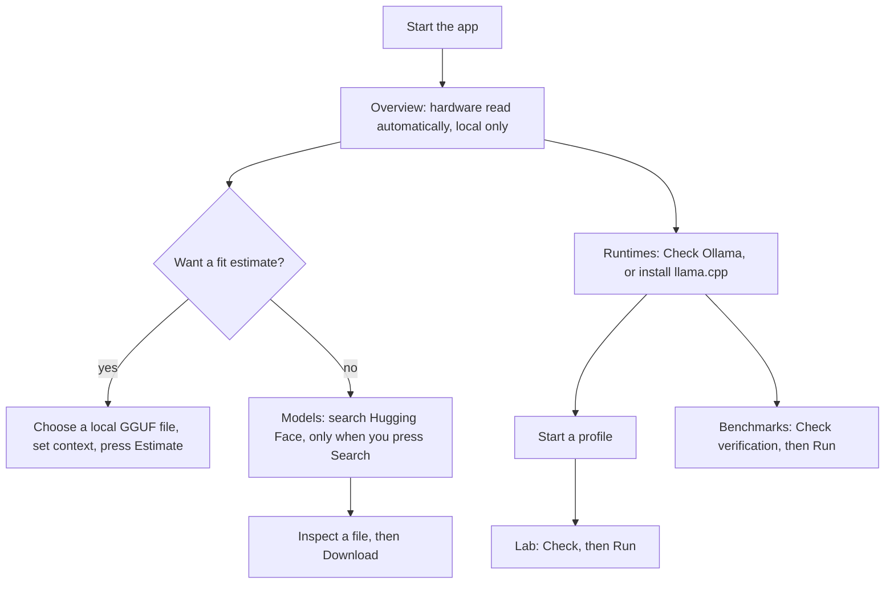

# Interface wireframes

Wireframes of the interface as implemented in 0.1.1, drawn from the widgets in
`crates/workstation-app/src/views/`. They show layout and states, not pixel-exact styling; the real
window follows the desktop theme, and exact wording of labels and values may differ from these sketches. Run the application to see it. Screenshots are not committed
because they show the tester's hardware.

There is no installer or setup wizard. A user builds from source, runs `local-ai-workstation`, and
lands on Overview. Nothing is configured before first use; every network action is a button.

## Window frame

```text
Wide (>= 700 sp)                                         Narrow (< 700 sp, down to 360 px)
┌────────────────────────────────────────────┐           ┌──────────────────────┐
│ [Overview][Models][Runtimes][Bench][Lab]  ☰│           │  Local AI Workstation│
├────────────────────────────────────────────┤           │  ☰                   │
│                                            │           ├──────────────────────┤
│              page content                  │           │    page content      │
│              (scrolls vertically)          │           │    (one column)      │
│                                            │           │                      │
├────────────────────────────────────────────┤           ├──────────────────────┤
│ status line: hardware · Ollama             │           │ status line          │
└────────────────────────────────────────────┘           │ [Ov][Mo][Ru][Be][La] │
                                                         └──────────────────────┘
```

Shortcuts: `Ctrl+1` … `Ctrl+5` pages, `Ctrl+K` model search, `Ctrl+R` refresh, `Ctrl+Q` quit.

## First-run journey



## Overview

```text
Overview & Monitor                                           [ Refresh ]
┌ Hardware ──────────────────────────────────────────────────────────────┐
│ CPU        <model> · 8 physical / 12 logical · AVX2                    │
│ RAM        15.32 GiB total · 5.42 GiB free                             │
│ GPU 1      <name> · VRAM 6.00 GiB (5.70 free) · CUDA 8.9               │
│ Notices    "GPU detected; memory probe not implemented"  (never zero)  │
└────────────────────────────────────────────────────────────────────────┘
┌ Memory scenarios ──────────────────────────────────────────────────────┐
│ GGUF file                 No file selected            [ Choose file… ] │
│ Requested context tokens  [ 8192 ]                                     │
│ Sequences [ 1 ]  Prompt microbatch tokens [ 512 ]                      │
│ ( ) Assume uniform full attention  (explicit assumption)               │
│ [ Estimate ]                                                           │
│ ── Result ──                                                           │
│ Weights ▇▇▇▇▇▇▇▇  K/V cache ▇▇▇  Buffers ▇  Runtime ▇                  │
│ Verdict: Comfortable · Constrained · Not recommended · Unknown         │
│ Layout warnings: No layout warnings.                                   │
└────────────────────────────────────────────────────────────────────────┘
Updates   Not checked. One request to GitHub, only if you press →  [ Check for updates ]
```

States: *detecting* (spinner), *partial* (some probes failed, others still shown), *stale* (a newer
refresh supersedes an older reply). Verdicts are always text, never colour alone.

## Models

```text
┌ [ Search Hugging Face GGUF models           ] [ Search ] ┐
│ Search runs only when you ask.                          │
├ ▸ Hugging Face access      (expander)                   │
│    Access token [••••••••]   [Save][Use saved][Check][Remove]
│    "Saved in your desktop keyring, never in a file."    │
├ Downloads                                               │
│  <file>.gguf   ▇▇▇▇▇░░░ 62 %   [Pause] [Discard]        │
├ Results                                                 │
│  ▸ org/model-GGUF      gated / public                   │
│      Q4_K_M  4.1 GiB   [Inspect] fit: Comfortable       │
│      Q8_0     7.2 GiB   already in Ollama               │
│  [ Load more ]                                          │
└─────────────────────────────────────────────────────────┘
```

Offline, the last saved first page is shown with a notice. Gated repositories explain what to do
on huggingface.co; Kvlm never accepts terms for you.

## Runtimes

```text
Runtimes & Endpoints                                        [ Refresh ]
┌ Ollama (attached, read-only) ──────────────────────────────────────────┐
│ Status: reachable · version · installed models                          │
│ [Model ▾]  [ Inspect ]   declared vs loaded context, memory, split      │
└────────────────────────────────────────────────────────────────────────┘
┌ llama.cpp (Managed) ───────────────────────────────────────────────────┐
│ ▸ Find builds      newest official release for this computer           │
│ ▸ Installed builds                                                     │
│ ▸ Launch profiles  model file · port · context · GPU layers            │
│ ▸ New profile                                                          │
│ Server:  stopped │ starting │ ready │ crashed(exit code)               │
│ [ Start ] [ Stop ] [ Restart ]     ▸ llama.cpp log (bounded)           │
└────────────────────────────────────────────────────────────────────────┘
┌ Other runtimes (read-only) ────────────────────────────────────────────┐
│ LM Studio   port [1234]  [ Check ]   models, loaded state               │
│ vLLM        port [8000]  [ Check ]   health, models, queue, KV cache    │
│ "Never started, stopped or changed here."                               │
└────────────────────────────────────────────────────────────────────────┘
```

## Benchmarks

```text
Benchmark Lab
Installed model  [ qwen2.5-coder:7b ▾ ]   Quick workload  (fixed prompt)
[ Check verification ]   No saved verification checked.
[ Run ]  [ Cancel ]
┌ Completed quick benchmark ─────────────────────────────────────────────┐
│ prompt processing · decode tokens/s · first token                       │
│ Observed memory peaks: RAM · VRAM · GTT  (coverage shown, unknown ≠ 0)  │
└────────────────────────────────────────────────────────────────────────┘
Recent benchmark history  [ Reload ]     Benchmark Verified badge when the
                                         manifest and hardware match exactly
```

## Lab

```text
Benchmark Lab                         target: managed llama.cpp (running)
[ ] Time a cold model load            [ Check ]  →  [ Run ] [ Cancel ]
┌ Result ───────────────────────────────────────────────────────────────┐
│ cold load · warm passes · prefill/decode speed · inter-token latency   │
│ coverage: which resource channels were measured                         │
└───────────────────────────────────────────────────────────────────────┘
┌ Diagnostics ──────────────────────────────────────────────────────────┐
│ DIAG-01..04 findings with evidence, or "not evaluated" with the reason │
└───────────────────────────────────────────────────────────────────────┘
┌ Stored experiments ───────────────────────────────────────────────────┐
│ <date> <profile>   [View] [Delete → Confirm delete]   (pick two)       │
│ [ Compare the two picked runs ]   controlled follow-up: change one     │
│ setting, restart, rerun, compare, restore the profile                  │
└───────────────────────────────────────────────────────────────────────┘
```

Check must be pressed before Run, and a changed profile or server invalidates the check. A run is
cancelled when the window closes.
