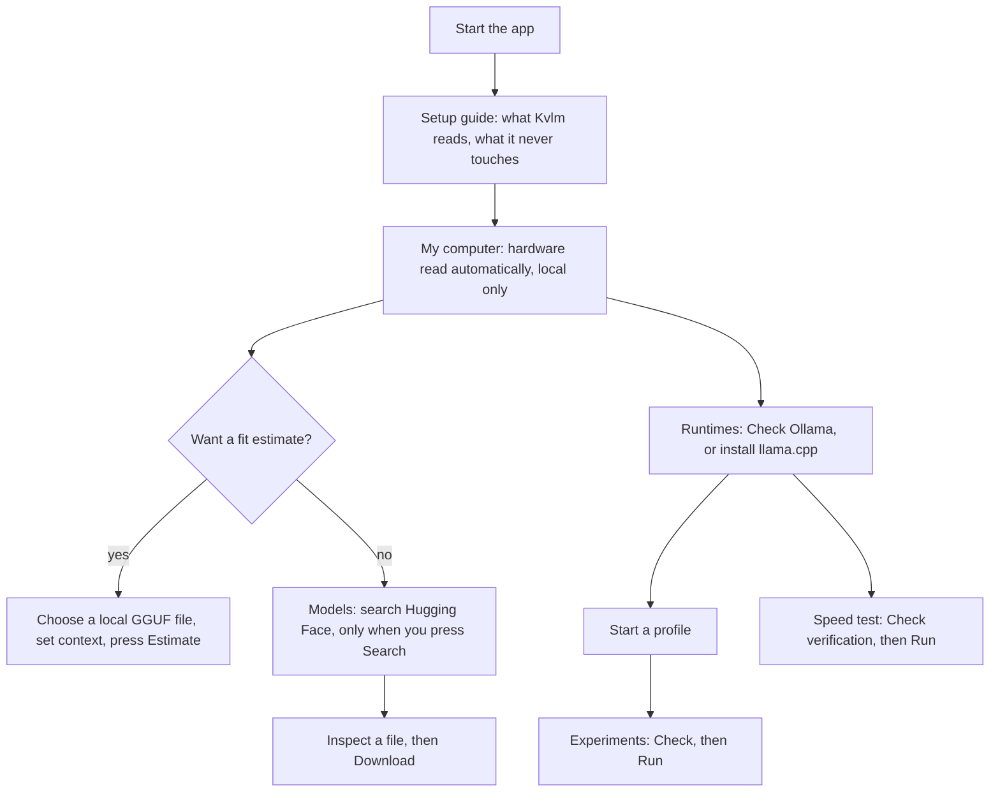

# Interface wireframes

Wireframes of the interface as implemented in 0.1.3, drawn from the widgets in
`crates/workstation-app/src/views/`. They show layout and states, not pixel-exact styling; the real
window follows the desktop theme, and exact wording of labels and values may differ from these sketches. Run the application to see it. The project site carries a few reviewed screenshots of the
reference machine.

Install with `scripts/install.sh` or build from source. On first run a setup guide explains what
Kvlm reads and what it never touches, then opens My computer. Nothing is configured before first
use; every network action is a button.

## Window frame

```text
Wide (>= 700 sp)                                         Narrow (< 700 sp, down to 360 px)
┌────────────────────────────────────────────┐           ┌──────────────────────┐
│ [My computer][Models][Runtimes][Speed][Exp]│           │  Local AI Workstation│
├────────────────────────────────────────────┤           │  ☰                   │
│                                            │           ├──────────────────────┤
│              page content                  │           │    page content      │
│              (scrolls vertically)          │           │    (one column)      │
│                                            │           │                      │
├────────────────────────────────────────────┤           ├──────────────────────┤
│ status line: hardware · Ollama             │           │ status line          │
└────────────────────────────────────────────┘           │ [My][Mo][Ru][Sp][Ex] │
                                                         └──────────────────────┘
```

Shortcuts: `Ctrl+1` … `Ctrl+5` pages, `Ctrl+K` model search, `Ctrl+R` refresh, `Ctrl+Q` quit.

## Palette and charts

Teal is the primary accent and amber the secondary data colour. Both light and dark palettes are
embedded stylesheets (`crates/workstation-app/src/theme/`); Libadwaita keeps ownership of window,
card and semantic colours, so yellow never stands in for success or warning. Change the palette from
System/Light/Dark in the header (display-brightness button) or in Preferences; the choice is saved
per user and charts repaint without a restart.

Charts are small Cairo drawings. Every chart is additive: a missing value hides the mark instead of
drawing a zero.

| Surface | Chart | Hidden when |
| --- | --- | --- |
| My computer | available/total meters for system RAM, dedicated VRAM and GTT | the pool was not read |
| Fit estimate | stacked weights, KV cache, buffers and runtime bar with comfortable/maximum marks | no breakdown or no budget limits |
| Speed test | decode-rate sparkline plus count, min, median and max of the newest 12 completed runs | fewer than two completed runs with server metrics |
| Experiments | one bar row per metric for baseline and candidate, own scale each, min–max whiskers | a metric is not measured on both runs |

Memory meters sit at the end of their pool row; hovering one shows the exact available, total and
percentage. Legends, axes, verdicts and the exact bytes stay as GTK labels, so screen readers and
the existing text report keep every number. Hover highlights a segment, bar or point; colour never
carries a verdict on its own.

## First-run journey



## My computer

```text
My computer                                           [ Refresh ]
┌ Hardware ──────────────────────────────────────────────────────────────┐
│ CPU        <model> · 8 physical / 12 logical                           │
│            [AVX2] [AVX-512] [VNNI] [AMX]   teal = reported             │
│ RAM        15.32 GiB total · 5.42 GiB free                             │
│            Available RAM  ▇▇▇▇▇░░░░░  5.42 of 15.32 GiB                │
│ GPU 1      <name> · VRAM 6.00 GiB (5.70 free) · CUDA 8.9               │
│            Dedicated VRAM ▇▇▇▇▇▇▇▇░  5.70 of 6.00 GiB                  │
│            GTT            Available unknown · 7.50 GiB total            │
│ Notices    "GPU detected; memory probe not implemented"  (never zero)  │
└────────────────────────────────────────────────────────────────────────┘
┌ Memory scenarios ──────────────────────────────────────────────────────┐
│ GGUF file                 No file selected            [ Choose file… ] │
│ Requested context tokens  [ 8192 ]                                     │
│ Sequences [ 1 ]  Prompt microbatch tokens [ 512 ]                      │
│ ( ) Assume uniform full attention  (explicit assumption)               │
│ [ Estimate ]                                                           │
│ ── Result ──                                                           │
│ Weights ▇▇▇▇▇▇▇▇  K/V cache ▇▇▇  Buffers ▇  Runtime ▇                  │
│ ┊ comfortable                 ┊ maximum                                │
│ legend: Weights 4.1 GiB · KV 1.2 GiB · Buffers 0.4 GiB · Runtime 0.6   │
│ Verdict: Comfortable · Constrained · Not recommended · Unknown         │
│ Layout warnings: No layout warnings.                                   │
└────────────────────────────────────────────────────────────────────────┘
Updates   Not checked. One request to GitHub, only if you press →  [ Check for updates ]
```

States: *detecting* (spinner), *partial* (some probes failed, others still shown), *stale* (a newer
refresh supersedes an older reply). Verdicts are always text, never colour alone.

## Models

```text
┌ [ Search Hugging Face GGUF models           ] [ Search ] ┐
│ Search runs only when you ask.                          │
├ ▸ Hugging Face access      (expander)                   │
│    Access token [••••••••]   [Save][Use saved][Check][Remove]
│    "Saved in your desktop keyring, never in a file."    │
├ Downloads                                               │
│  <file>.gguf   ▇▇▇▇▇░░░ 62 %   [Pause] [Discard]        │
├ Results                                                 │
│  ▸ org/model-GGUF      gated / public                   │
│      Q4_K_M  4.1 GiB   [Inspect] fit: Comfortable       │
│      Q8_0     7.2 GiB   already in Ollama               │
│  [ Load more ]                                          │
└─────────────────────────────────────────────────────────┘
```

Offline, the last saved first page is shown with a notice. Gated repositories explain what to do
on huggingface.co; Kvlm never accepts terms for you.

## Runtimes

```text
Your runtimes                                        [ Refresh ]
┌ Ollama (attached, read-only) ──────────────────────────────────────────┐
│ Status: reachable · version · installed models                          │
│ [Model ▾]  [ Inspect ]   declared vs loaded context, memory, split      │
└────────────────────────────────────────────────────────────────────────┘
┌ Run models with llama.cpp ───────────────────────────────────────────────────┐
│ ▸ Find builds      newest official release for this computer           │
│ ▸ Installed builds                                                     │
│ ▸ Launch profiles  model file · port · context · GPU layers            │
│ ▸ New profile                                                          │
│ Server:  stopped │ starting │ ready │ crashed(exit code)               │
│ [ Start ] [ Stop ] [ Restart ]     ▸ llama.cpp log (bounded)           │
└────────────────────────────────────────────────────────────────────────┘
┌ Other runtimes (read-only) ────────────────────────────────────────────┐
│ LM Studio   port [1234]  [ Check ]   models, loaded state               │
│ vLLM        port [8000]  [ Check ]   health, models, queue, KV cache    │
│ "Never started, stopped or changed here."                               │
└────────────────────────────────────────────────────────────────────────┘
```

## Speed test

```text
Speed test
Installed model  [ qwen2.5-coder:7b ▾ ]   Quick workload  (fixed prompt)
[ Check verification ]   No saved verification checked.
[ Run ]  [ Cancel ]
┌ Completed quick benchmark ─────────────────────────────────────────────┐
│ prompt processing · decode tokens/s · first token                       │
│ Observed memory peaks: RAM · VRAM · GTT  (coverage shown, unknown ≠ 0)  │
└────────────────────────────────────────────────────────────────────────┘
Recent benchmark history  [ Reload ]     Benchmark Verified badge when the
                                         manifest and hardware match exactly
Generation speed over saved runs
  ╭──────────────────────────────────────────────────────────╮
  │        •───•        •                                     │
  │   •───╯     ╰──•───╯   hover a point for run and rate     │
  ╰──────────────────────────────────────────────────────────╯
12 saved runs · min 18.2 · median 24.9 · max 31.4 tokens/s
```

## Experiments

```text
Experiments                           target: managed llama.cpp (running)
[ ] Time a cold model load            [ Check ]  →  [ Run ] [ Cancel ]
┌ Result ───────────────────────────────────────────────────────────────┐
│ cold load · warm passes · prefill/decode speed · inter-token latency   │
│ coverage: which resource channels were measured                         │
└───────────────────────────────────────────────────────────────────────┘
┌ Diagnostics ──────────────────────────────────────────────────────────┐
│ DIAG-01..04 findings with evidence, or "not evaluated" with the reason │
└───────────────────────────────────────────────────────────────────────┘
┌ Stored experiments ───────────────────────────────────────────────────┐
│ <date> <profile>   [View] [Delete → Confirm delete]   (pick two)       │
│ [ Compare the two picked runs ]   controlled follow-up: change one     │
│ setting, restart, rerun, compare, restore the profile                  │
│ Measured change, one scale per metric   [Baseline] [Candidate]         │
│ Generation speed   +8.4%   clearly better                              │
│   ▇▇▇▇▇▇▇▇▇▇▇▇  baseline (amber)  ── range                              │
│   ▇▇▇▇▇▇▇▇▇▇▇▇▇ candidate (teal) ── range                              │
│ Time to first token  not measured on both runs (no bar)                │
└───────────────────────────────────────────────────────────────────────┘
```

Check must be pressed before Run, and a changed profile or server invalidates the check. A run is
cancelled when the window closes.
