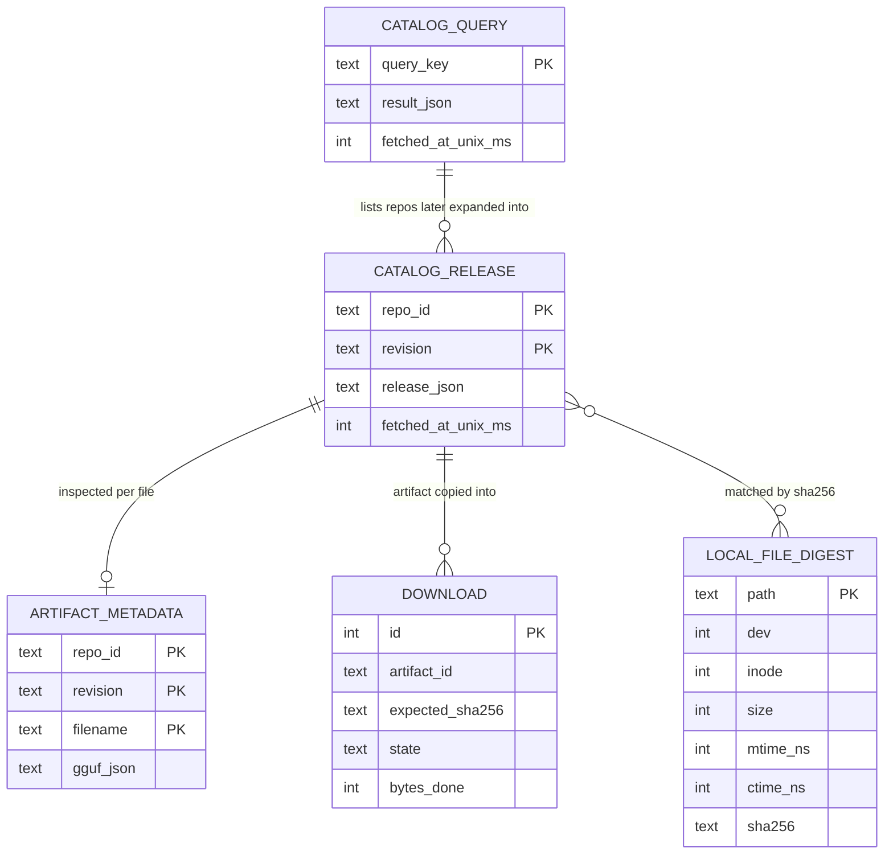
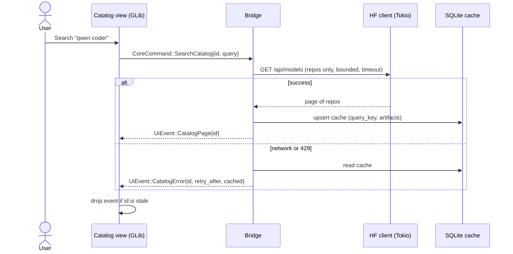
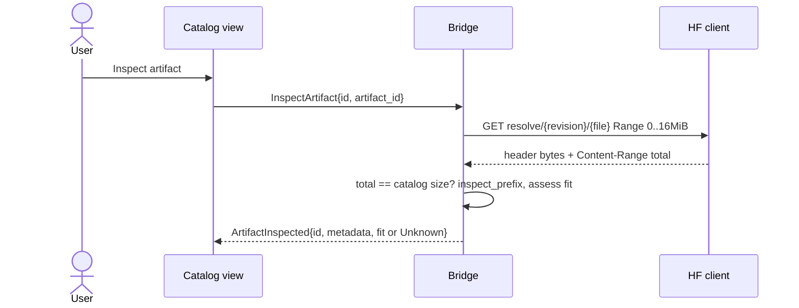
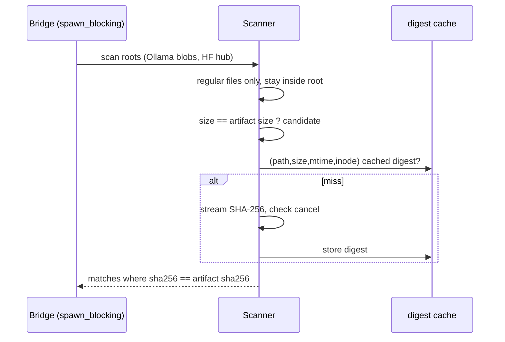
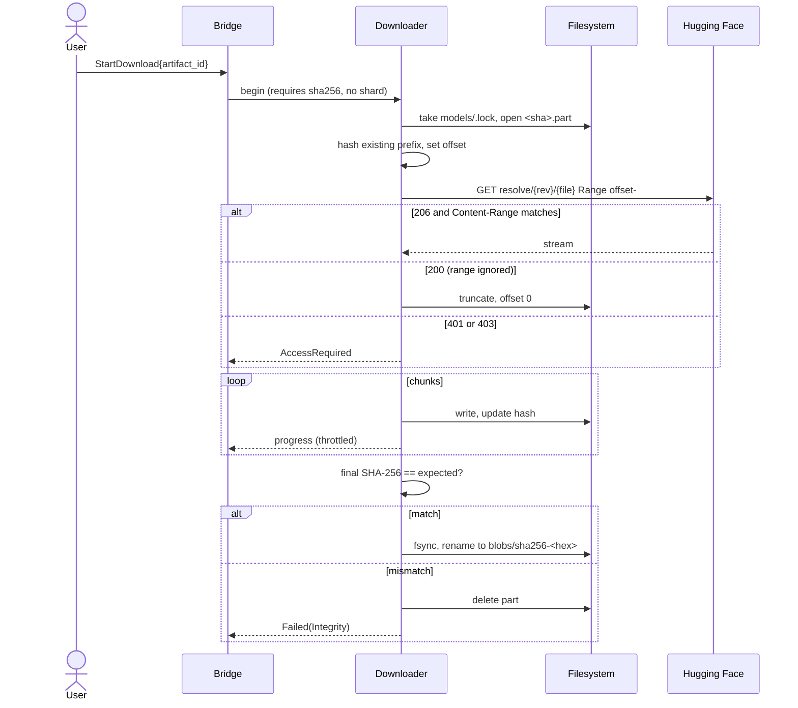
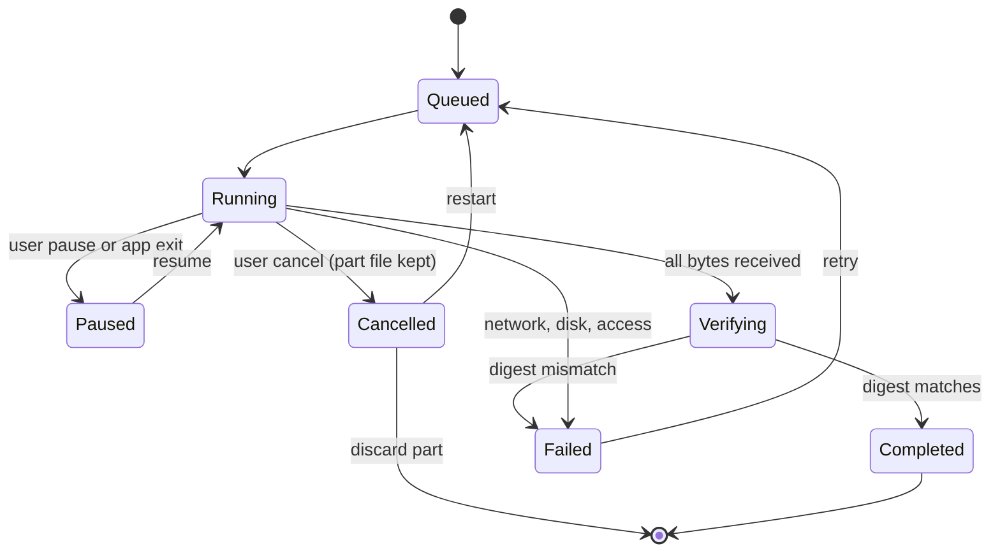
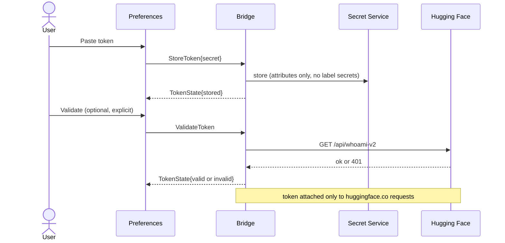

# M1 diagrams

Companion documents: [Planned](Planned.md) · [Implementation](Implementation.md)

## Entities

## Search and browse

## Artifact inspection

## Deduplication

## Download

## Download lifecycle

## Token handling

